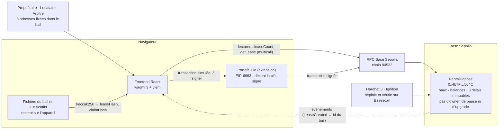

# Architecture

Vue d’ensemble de Caution : qui parle à qui, où sont les fonds, où sont les documents.

## Points clés

- **Le frontend ne détient ni clé ni fonds.** Il lit la chaîne, simule chaque transaction pour décoder un éventuel refus du contrat, puis la confie au portefeuille qui signe.
- **La caution est en ETH natif dans le contrat.** Elle ne sort que par `withdraw`, après qu’une transition a crédité le solde du bénéficiaire.
- **Personne ne contrôle le contrat après le déploiement.** Le déployeur fixe seulement les trois délais (`claimWindow`, `responseWindow`, `arbitrationWindow`), 120 s chacun avec `ignition/parameters/demo.json`.
- **Les documents restent hors chaîne.** Seule leur empreinte keccak256 est enregistrée dans le bail.
- **L’identifiant d’un nouveau bail vient de l’événement `LeaseCreated`**, pas de `leaseCount`, car un autre bail peut être créé entre-temps.
