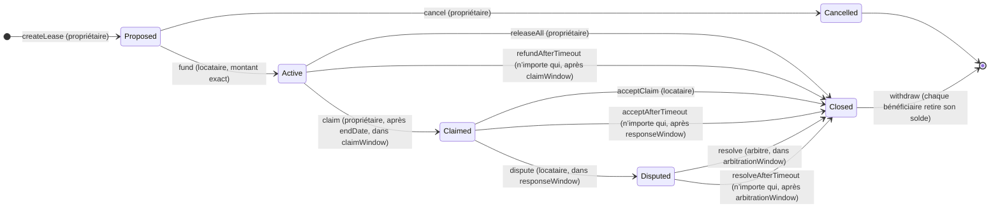

# Cycle de vie d’un bail

États de `RentalDeposit.Status` et transitions possibles. Chaque état où l’on attend quelqu’un a une sortie par délai, déclenchable par n’importe qui : la caution ne reste jamais bloquée.

## Qui reçoit quoi

| Transition | Propriétaire | Locataire |
|---|---|---|
| `releaseAll` | 0 | toute la caution |
| `refundAfterTimeout` | 0 | toute la caution |
| `claim` | rien encore | `deposit - claimAmount`, crédité immédiatement |
| `acceptClaim`, `acceptAfterTimeout` | `claimAmount` | 0 de plus |
| `resolve(toLandlord)` | `toLandlord` | `claimAmount - toLandlord` |
| `resolveAfterTimeout` | 0 | `claimAmount` |

Les transitions ne font que créditer `balances` ; l’ETH ne quitte le contrat que par `withdraw`.

## Délais

| Délai | Commence à | Sans action à temps |
|---|---|---|
| `claimWindow` | `endDate` | toute la caution revient au locataire |
| `responseWindow` | la réclamation (`claimedAt`) | la réclamation est acquise au propriétaire |
| `arbitrationWindow` | la contestation (`disputedAt`) | le montant contesté revient au locataire |

Une action est permise tant que `block.timestamp <= deadline`, la fonction `...AfterTimeout` correspondante seulement après : les deux ne sont jamais possibles en même temps. En production 60, 14 et 30 jours ; 120 s chacun avec `ignition/parameters/demo.json`.
